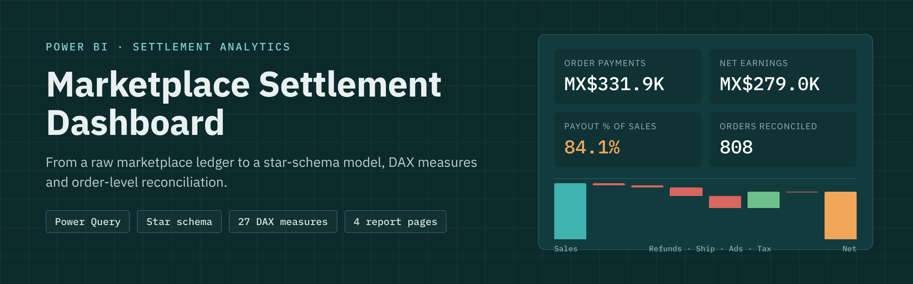
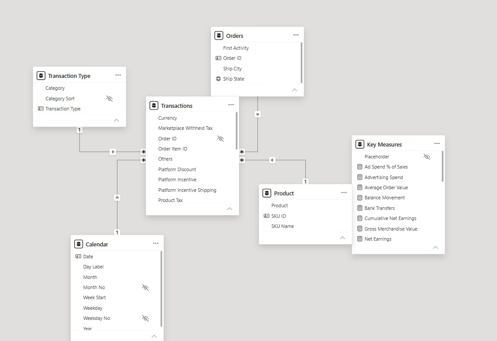
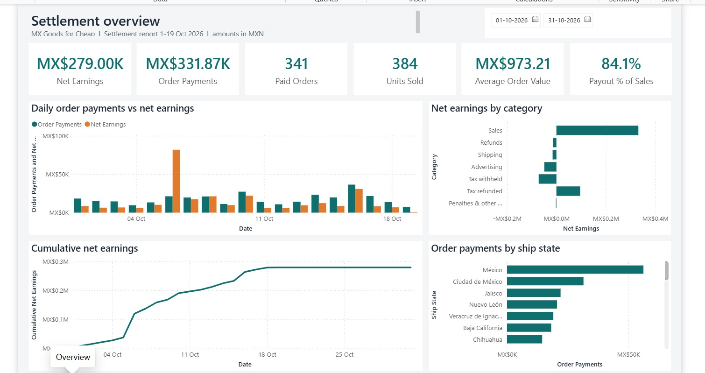
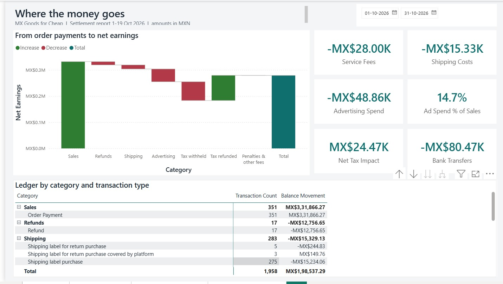

<p align="center">
  
</p>

<h1 align="center">Marketplace Settlement Dashboard (Power BI)</h1>

<p align="center">
  <em>Turning a raw e-commerce settlement ledger into a star-schema Power BI model with DAX measures and order-level reconciliation</em>
</p>

<p align="center">
  
  
  
  
  
  <a href="https://sanjibsamadder.github.io/mx-settlement-dashboard/"></a>
</p>

---

## Overview

Marketplace settlement exports are ledgers, not sales reports. Every row is a single money movement: an order payment, a refund, a shipping label, an advertising charge, a tax withholding, a tax refund or a bank transfer. A single order can produce several rows on different days, which makes the raw file hard to read and easy to misreport.

This project takes the settlement ledger of a Mexican marketplace store (**MX Goods for Cheap**, 1–19 October 2026, amounts in MXN) and builds a Power BI report that answers four questions:

1. **How did the period perform?** Order payments, net earnings, orders, units, average order value and payout %.
2. **Where does the money go?** A waterfall from order payments to net earnings across refunds, shipping, advertising, tax and penalties.
3. **What sells, and where?** Order payments by product and by ship state.
4. **What happened to each order?** Payment, fees, tax and refunds reconciled per order, including orders whose payment falls outside the period.

The project is saved as a **Power BI Project (.pbip)**, so the semantic model (TMDL) and report (PBIR) are plain text and fully version-controlled.

## Key Result

> **MX$331,866 of order payments became MX$279,004 of net earnings, an 84.1% payout.** About 7 points of that payout come from tax-refund timing; the underlying trading payout is closer to **77%**. **Advertising, at 14.7% of sales, is the largest controllable cost.**

**Headline KPIs (1–19 Oct 2026)**

| KPI | Value |
|---|---|
| Order Payments | MX$331,866.27 |
| Net Earnings | MX$279,004.19 |
| Payout % of Sales | 84.1% |
| Paid Orders | 341 |
| Units Sold | 384 |
| Average Order Value | MX$973.21 |
| Gross Merchandise Value | MX$367,714.19 |

**From order payments to net earnings**

| Category | MX$ | % of order payments |
|---|---:|---:|
| Order payments | +331,866.27 | 100.0% |
| Refunds | −12,756.65 | −3.8% |
| Shipping | −15,329.13 | −4.6% |
| Advertising | −48,863.88 | −14.7% |
| Tax withheld (ISR / VAT) | −71,735.46 | −21.6% |
| Tax refunded | +96,207.24 | +29.0% |
| Penalties & other fees | −384.20 | −0.1% |
| **Net earnings** | **279,004.19** | **84.1%** |
| *Bank transfer (excluded, seller withdrawal)* | *−80,466.90* | |

## Dashboard Preview

**Data model: star schema**

<p align="center"></p>

**Page 1: Overview**

<p align="center"></p>

**Page 2: Fees & Payout**

<p align="center"></p>

An interactive web version of all four pages is available at **[sanjibsamadder.github.io/mx-settlement-dashboard](https://sanjibsamadder.github.io/mx-settlement-dashboard/)**.

## Main Findings

1. **A naive import loses about 70% of sales.** Amounts of 1,000 or more are stored as text with thousands separators (e.g. `"-80,466.90"`). Loaded without handling this, order payments come out at about MX$96K instead of MX$332K. Power Query strips the separators before converting to numbers.
2. **The headline payout is flattered by tax timing.** MX$96.2K of tax was refunded against MX$71.7K withheld. Excluding tax effects, payout is about 77% rather than 84%.
3. **One day holds a one-off bulk tax refund.** All 402 income-tax (ISR) refund rows in the file are dated 6 October, adding MX$71.5K of tax refunds that day. Underlying net earnings on 6 October were about MX$10K, in line with other days.
4. **Advertising is the biggest controllable cost.** MX$48.9K (14.7% of sales), charged 142 times in 19 days, which is more than shipping and refunds combined.
5. **58% of orders had money movement without a sale in the period.** Of 808 orders with activity, only 341 were paid in the window: 399 had only tax refunds (sold before October), 60 had only a shipping label (payment not yet released) and 8 had late refunds or penalties.
6. **A high-ticket, single-item store.** Average order value is MX$973, and 325 of 351 order lines are a single unit.
7. **No single product carries the store.** 125 products sold; the top 10 make up 32% of order payments. The best seller (a folding poker table) earned MX$16.8K from just 3 orders.
8. **Demand follows population centres.** Estado de México, Ciudad de México and Jalisco account for a third of order payments across 31 states.
9. **Simple ratios mislead on short windows.** Shipping cost per paid order is MX$45 on a simple ratio, but about MX$57 when each label is matched to its own order. The refund rate is 5.0% by order count but 3.8% by value.

## Report Pages and Model Components

**Report pages**

| Page | Question it answers | Key visuals | Key measures |
|---|---|---|---|
| Overview | How did the period perform? | KPI cards, daily payments vs net earnings, earnings by category, cumulative earnings, payments by state | Net Earnings, Order Payments, Paid Orders, Units Sold, Average Order Value, Payout % of Sales |
| Fees & Payout | Where does the money go? | Waterfall, cost cards, ledger matrix by category and type | Service Fees, Shipping Costs, Advertising Spend, Ad Spend % of Sales, Net Tax Impact, Bank Transfers |
| Products & Regions | What sells, and where? | Payments by product, orders by state, product performance table | Order Payments, Paid Orders, Units Sold, Average Order Value |
| Order Reconciliation | What happened to each order? | Reconciliation cards, ship-state filter, net earnings per order table | Orders with Activity, Orders without Payment in Period, Refund Rate %, Shipping Cost per Order |

**Data model (star schema)**

| Table | Type | Grain | Rows | Built from |
|---|---|---|---:|---|
| Transactions | Fact | One ledger movement | 1,958 | Cleaned settlement ledger |
| Calendar | Dimension | One day | 31 | Generated from the data's date range, marked as date table |
| Orders | Dimension | One order | 808 | Distinct Order IDs; ship city/state lifted to order level |
| Product | Dimension | One SKU | 125 | Distinct SKU IDs, with a short chart label |
| Transaction Type | Dimension | One raw transaction type | 15 | Mapped to 8 reporting categories with a sort order |
| Key Measures | Measures | – | – | 27 DAX measures in 5 display folders |

All four relationships are many-to-one and single-direction, from each dimension to `Transactions`. A single Power Query staging query (`Settlement`) reads and cleans the export once; every table references it.

**Measure folders**

| Folder | Measures |
|---|---|
| 1 Payout | Net Earnings, Bank Transfers, Balance Movement, Cumulative Net Earnings, Payout % of Sales |
| 2 Sales | Order Payments, Gross Merchandise Value, Platform Discounts, Seller Discounts, Service Fees, Paid Orders, Units Sold, Average Order Value |
| 3 Costs | Refunds, Shipping Costs, Advertising Spend, Penalties & Other Fees, Ad Spend % of Sales, Shipping Cost per Order |
| 4 Tax | Tax Withheld, Tax Refunded, Net Tax Impact |
| 5 Quality | Transaction Count, Orders with Activity, Orders without Payment in Period, Refunded Orders, Refund Rate % |

Example measures:

```dax
Net Earnings =
CALCULATE ( SUM ( Transactions[Total] ), 'Transaction Type'[Category] <> "Bank transfer" )

Paid Orders =
CALCULATE ( DISTINCTCOUNT ( Transactions[Order ID] ), 'Transaction Type'[Category] = "Sales" )

Orders without Payment in Period =
COUNTROWS (
    FILTER (
        DISTINCT ( Orders[Order ID] ),
        NOT ISBLANK ( CALCULATE ( COUNTROWS ( Transactions ) ) )
            && ISBLANK ( [Order Payments] )
    )
)
```

## Dataset

| Item | Detail |
|---|---|
| Source | Marketplace settlement report export (`Data/MX-GOODS_Settlement_2026-10-01_to_2026-10-19.xlsx`) |
| Period | 1–19 October 2026 |
| Currency | MXN (Mexican peso) |
| Size | 1,958 rows × 24 columns, one sheet |
| Grain | One row per money movement |
| Transaction types | 15, grouped into 8 categories: Sales, Refunds, Shipping, Advertising, Tax withheld, Tax refunded, Penalties & other fees, Bank transfer |
| Key columns | Date/time, Transaction type, Order ID, Order item ID, SKU, SKU ID, Quantity, Ship city, Ship state, 13 amount columns, Total, Currency |

Row-level logic confirmed across the file: `Subtotal = Retail price + discounts + service fee + platform incentive`, and `Total = Subtotal + shipping + taxes + others` on every payment and refund row.

## Repository Structure

```
marketplace-settlement-dashboard-powerbi/
├── MXGoods_Settlement.pbip              # Open this in Power BI Desktop
├── MXGoods_Settlement.SemanticModel/    # Data model as TMDL (tables, relationships, measures, Power Query)
│   └── definition/
│       ├── tables/                      # Transactions, Calendar, Orders, Product, Transaction Type, Key Measures
│       ├── relationships.tmdl
│       └── expressions.tmdl             # SourceFilePath parameter + Settlement staging query
├── MXGoods_Settlement.Report/           # Report as PBIR (4 pages, 36 visuals, theme)
├── Data/
│   └── MX-GOODS_Settlement_2026-10-01_to_2026-10-19.xlsx
├── validation/
│   └── verify_kpis.py                   # Recalculates every KPI from the raw Excel file
├── assets/                              # Banner and screenshots
├── LICENSE
└── README.md
```

## Getting Started

**Requirements:** Windows with [Power BI Desktop](https://www.microsoft.com/power-platform/products/power-bi/desktop) (free).

1. **Clone or download** the repository and extract it if downloaded as a zip.
2. **Open** `MXGoods_Settlement.pbip` in Power BI Desktop.
   If prompted, enable *File → Options and settings → Options → Preview features → Power BI Project (.pbip)* and restart.
3. **Point to the data file:** *Home → Transform data → Edit parameters*, set `SourceFilePath` to the full path of `Data/MX-GOODS_Settlement_2026-10-01_to_2026-10-19.xlsx` and click **OK**. Quotes from *Copy as path* are handled automatically.
4. **Refresh:** click **Apply changes** or *Home → Refresh*.
5. **Optional:** *File → Save as → Power BI file (.pbix)* to create a single shareable file.

**Check the setup:** after refresh, Net Earnings should read **MX$279,004.19**, Order Payments **MX$331,866.27** and Paid Orders **341**.

**Verify the numbers independently (optional):**

```bash
pip install openpyxl
python validation/verify_kpis.py
```

## Limitations

- **Short window.** 19 days of settlement data cut many orders in half: 467 of 808 orders have activity in the period but no payment in it. Per-order profit is only reliable for orders whose full lifecycle falls inside the date range.
- **Tax timing.** Withheld and refunded tax land on different dates, so net earnings and payout % move with tax adjustments, not only with trading.
- **Refund matching.** 4 of the 17 refunds relate to orders paid before the period, and several are partial, so the order-count refund rate (5.0%) slightly overstates returns.
- **Gross units.** Units Sold (384) is gross; returned units are not deducted.
- **Single store, single currency.** The model assumes one marketplace account in MXN.
- **Locale display.** Number grouping follows the Windows region setting (e.g. 3,31,866 under an Indian locale).

## Provenance & License

- **Data:** a marketplace settlement export for *MX Goods for Cheap*, provided as part of a Power BI assessment task. The data belongs to its owner and is included only so the report can be refreshed and reviewed. It is not covered by this repository's license.
- **Model, report, scripts and documentation:** © 2026 Sanjib Samadder, released under the [MIT License](LICENSE).
- **Validation:** all KPIs were reconciled against an independent recalculation from the raw Excel file (`validation/verify_kpis.py`).

## Future Work

- [ ] Extend to 60–90 days of settlement data so most orders show their full lifecycle
- [ ] Add a *Net Earnings excl. Tax* measure to separate tax timing from trading performance
- [ ] Allocate advertising spend to products to measure return on ad spend (ROAS)
- [ ] Match each refund and shipping label to its original order for true per-order profit
- [ ] Add month-over-month comparisons once more periods are available
- [ ] Publish to the Power BI Service with scheduled refresh from new settlement exports
- [ ] Add alerts for penalties such as delayed-fulfilment deductions and chargebacks

## Author

**Sanjib Samadder**
Data Analyst · MSc Data Science, University of Leicester

<p>
  <a href="mailto:s.samadder.analytics@gmail.com"></a>
  <a href="https://github.com/sanjibSamadder"></a>
  <a href="https://www.linkedin.com/in/sanjibsamadder"></a>
  <a href="https://sanjibsamadder.github.io"></a>
</p>

## Disclaimer

This project was created as a Power BI assessment and portfolio piece. The analysis describes one 19-day settlement export and is not financial, tax or accounting advice. Tax figures (ISR and VAT withholding and refunds) are reported as they appear in the ledger; their treatment for any seller depends on that seller's tax registration and should be confirmed with a qualified accountant.
